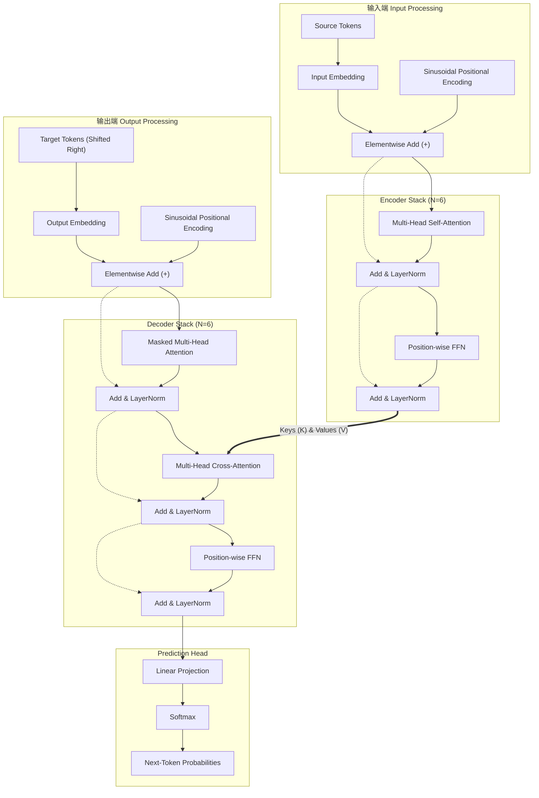
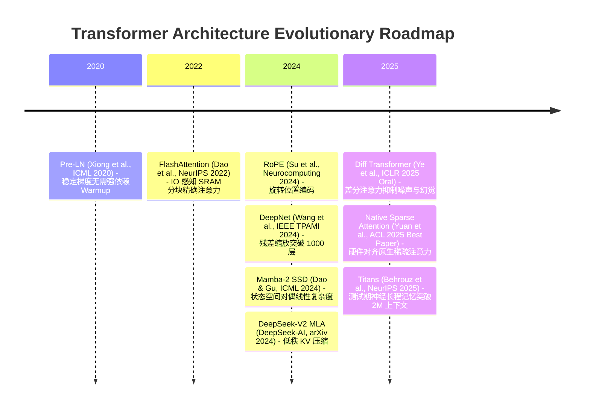

# Attention Is All You Need

 &nbsp; 

- **发表出处**：NeurIPS 2017 (Vaswani et al.)
- **核心创新**：纯注意力无循环无卷积架构、缩放点积注意力、多头注意力、正弦连续位置编码、Post-LN、因果掩码、交叉注意力、Noam 调度与正则化组合（9 项全量拆解）
- **深度解构文件**：[notebook.ipynb](notebook.ipynb)

> 包含数学公式推导、**严格单格自包含可运行 Mock 代码**（FP16-safe Mask、通过 `nbformat 4.5` 与 `symtable` 校验）、精准锚定原论文 Table 3 的消融证据链，以及经文献核验的 2020–2025 顶会顶刊演进路线（Pre-LN、FlashAttention、DeepNet、Mamba-2、DeepSeek-V2 MLA、Diff Transformer ICLR'25、NSA ACL'25、Titans NeurIPS'25）。请点击上方徽章或直接查看 [notebook.ipynb](notebook.ipynb)。

---

## 模型整体拓扑图（GitHub 原生 Mermaid 视图）

## 后续顶会顶刊演进时间线

