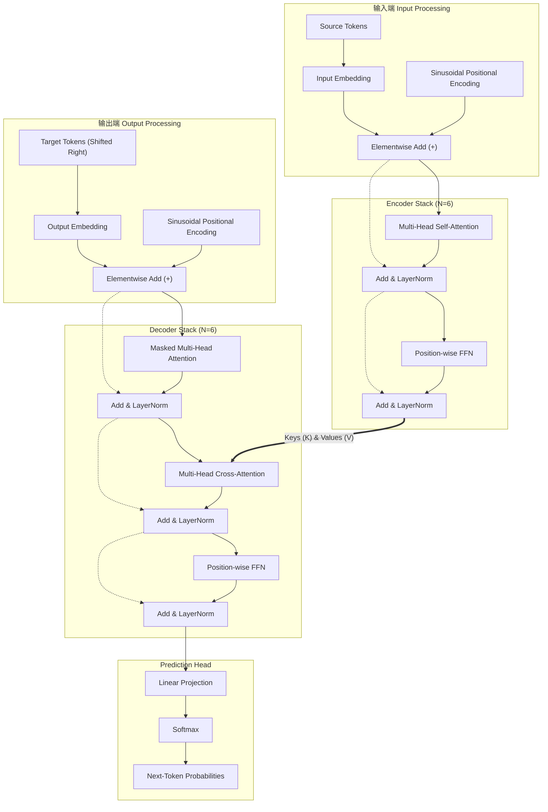
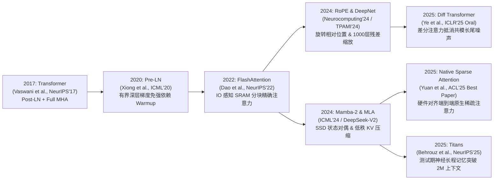

# Attention Is All You Need

 &nbsp; 

- **发表出处**：NeurIPS 2017 (Vaswani et al.)
- **核心创新**：纯注意力无循环无卷积架构、缩放点积注意力、多头注意力、正弦连续位置编码、Post-LN、因果掩码、交叉注意力、Noam 调度与标签平滑正则化组合（9 项全量拆解 + 6 大自包含可运行 PyTorch 积木块）
- **深度解构文件**：[notebook.ipynb](notebook.ipynb)

> 包含数学公式推导、**内嵌预渲染高清架构图 (`image/png`)**、**6 个严格单格自包含可运行 Mock 代码单元**（涵盖 SDPA、MHA、Sinusoidal PE、Encoder Layer、Masked & Cross-Attention Decoder Layer、Noam Scheduler & Label Smoothing，通过 `nbformat 4.5` 与 AST 顺序感知 + `symtable` 校验）、精准锚定原论文 Table 3 的消融证据链，以及经文献核验的 2020–2025 顶会顶刊演进路线（Pre-LN、FlashAttention、RoPE、DeepNet、Mamba-2、DeepSeek-V2 MLA、Diff Transformer ICLR'25、NSA ACL'25、Titans NeurIPS'25）。请点击上方徽章或直接查看 [notebook.ipynb](notebook.ipynb)。

---

## 模型整体拓扑图（GitHub 原生 Mermaid 视图）

## 后续顶会顶刊演进路线图（2017 → 2025）

