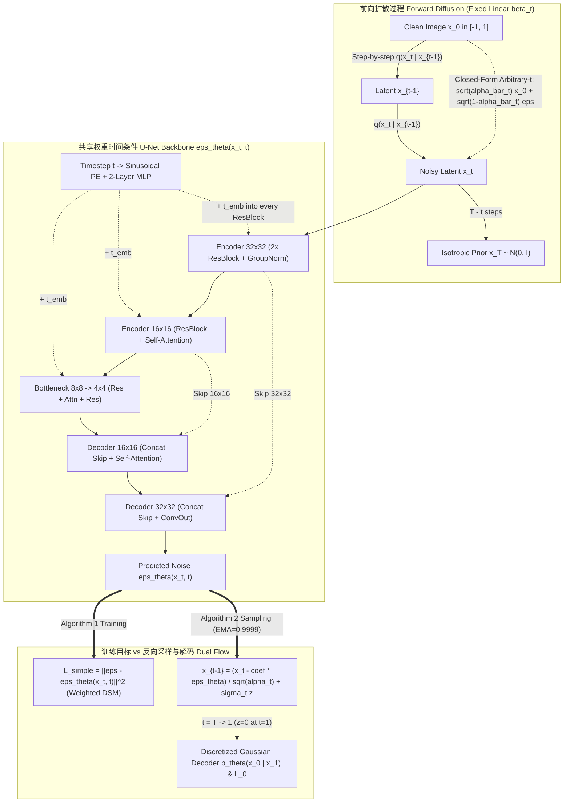
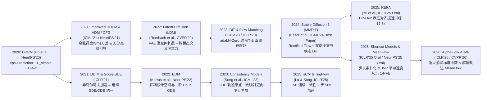

# Denoising Diffusion Probabilistic Models (DDPM)

 &nbsp; 

- **发表出处**：NeurIPS 2020 (Jonathan Ho, Ajay Jain, Pieter Abbeel)
- **核心创新**：固定线性方差前向扩散与闭式任意步采样、Rao-Blackwellized 低方差变分下界分解、固定各向同性反向方差边界、$\epsilon$-预测重参数化与去噪分数匹配/朗之万动力学理论等价、加权简化目标 $L_{\text{simple}}$、$[-1, 1]$ 离散高斯解码器 $L_0$、时间正弦嵌入 + GroupNorm + $16\times 16$ 自注意力 U-Net 与 EMA、渐进有损解压与广义自回归解码、潜空间粗到细插值（9 项全量拆解 + 7 大自包含可运行 PyTorch 积木块）
- **深度解构文件**：[notebook.ipynb](notebook.ipynb)

> 包含严谨公式推导、**内嵌预渲染高清架构图 (`image/png`)**、**7 个严格单格自包含可运行 Mock 代码单元**（涵盖线性噪声调度与闭式后验、VLB 权重与 $L_{\text{simple}}$ 对比、256 级离散高斯解码器、正弦时间嵌入与 GroupNorm 残差块、多尺度 $16\times 16$ 自注意力 U-Net 与 EMA、朗之万式反向采样与渐进 $\hat{x}_0$ 重建、随机潜空间粗到细插值，全部通过 `nbformat 4.5` 与 AST 顺序流 + `symtable` 校验）、精准锚定原论文 Table 1–4 与 Appendix A–D 的消融证据链，以及经文献核验的 **2021–2026** 顶会演进路线（DDIM、Score-SDE、Improved DDPM、ADM & CFG、LDM、EDM、Flow Matching、Consistency Models、DiT、SD3 MMDiT、sCM/TrigFlow ICLR'25、REPA ICLR'25 Oral、Shortcut Models ICLR'25 Oral、MeanFlow NeurIPS'25 Oral、AlphaFlow ICLR'26 & Decoupled/Improved MeanFlow CVPR'26）。请点击上方徽章或直接查看 [notebook.ipynb](notebook.ipynb)。

---

## 模型整体拓扑图（GitHub 原生 Mermaid 视图）

## 后续顶会顶刊演进路线图（2020 → 2026）

