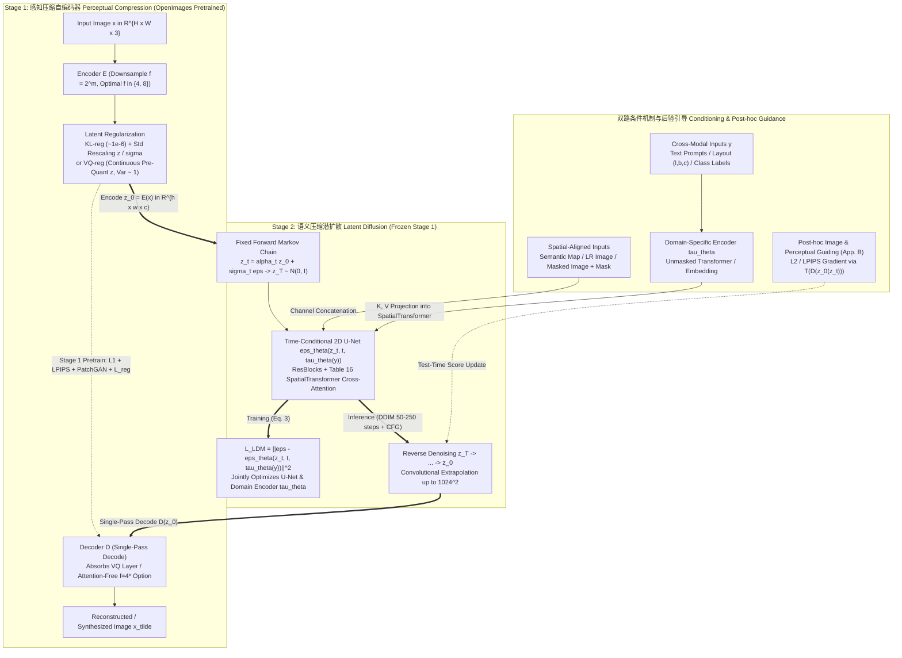
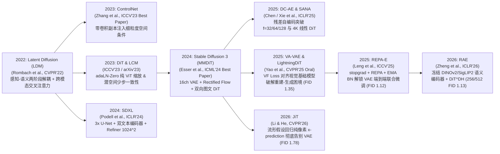

# High-Resolution Image Synthesis with Latent Diffusion Models (LDM)

 &nbsp; 

- **发表出处**：CVPR 2022 (Robin Rombach*, Andreas Blattmann*, Dominik Lorenz, Patrick Esser, Björn Ommer)
- **核心创新**：感知压缩与语义压缩两阶段解耦、温和 2D 下采样（$f\in\{4,8\}$）与 KL-reg / 吸收式 VQ-reg 第一阶段自编码器、潜空间首批次标准差缩放与 SNR 校准（`0.18215` 溯源）、潜空间 2D 卷积 U-Net 与 SNR-ELBO 目标 $L_{\text{LDM}}$、领域专家编码器 $\tau_\theta$ 与 Table 16 Spatial Transformer 跨模态交叉注意力、双路条件路由与超越 $256^2$ 的百万像素卷积外推、无注意力高分解码器（$f=4^\dagger$）与半轮 $512^2$ 微调、后验图像/感知引导（Appendix B Eq. 16–17）、潜空间 CFG 与盲超分随机退化管线 LDM-BSR（9 项全量拆解 + 7 大自包含可运行 PyTorch 积木块）
- **深度解构文件**：[notebook.ipynb](notebook.ipynb)

> 包含严谨公式推导与原文笔误勘误、**内嵌预渲染高清架构图 (`image/png`)**、**7 个严格单格自包含可运行 Mock 代码单元**（涵盖 KL-reg / 吸收式 VQ-reg 第一阶段自编码器、首批次标准差缩放与 SNR-ELBO 恒等式校验、领域编码器 $\tau_\theta$ 与 Table 16 Spatial Transformer 交叉注意力、Cross-Attention vs Spatial Concatenation 双路 U-Net 骨干、超越 $256^2$ 卷积外推与无注意力解码器显存对比、潜空间 CFG + DDIM 加速采样闭环、Appendix B 后验图像/感知引导与 LDM-BSR 随机退化管线，全部通过 `nbformat 4.5` 与 AST 顺序流 + `symtable` + FP16 安全掩码校验）、精准锚定原论文 Table 1–18 与 Appendix A–H 的消融/算力证据链，以及经文献核验的 **2022–2026** 顶会演进路线（ControlNet ICCV'23 Best Paper、DiT ICCV'23、LCM、SDXL ICLR'24、SD3 MMDiT ICML'24 Best Paper、DC-AE & SANA ICLR'25、VA-VAE / LightningDiT CVPR'25 Oral、REPA-E ICCV'25、RAE ICLR'26 & JiT CVPR'26）。请点击上方徽章或直接查看 [notebook.ipynb](notebook.ipynb)。

---

## 模型整体拓扑图（GitHub 原生 Mermaid 视图）

## 后续顶会顶刊演进路线图（2022 → 2026）

